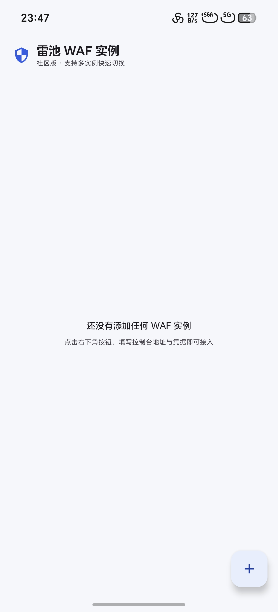
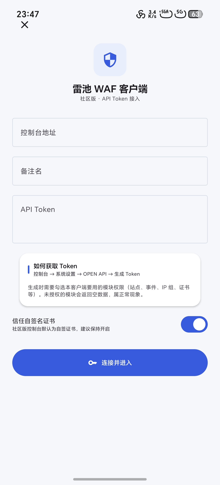
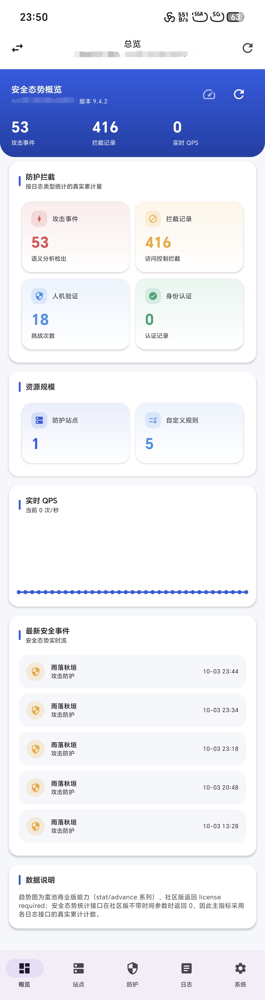

# 雷池 WAF 社区版 · Android 客户端

面向 [雷池 SafeLine 社区版](https://waf-ce.chaitin.cn/) 的原生安卓管理客户端。
使用 Kotlin + Jetpack Compose + Material 3 编写，**支持多实例（多账号）快速切换**，凭据由 Android Keystore 加密落盘。

- 包名：`xyz.anye.wafce`
- 最低支持：Android 8.0（API 26）
- 构建产物：`app/build/outputs/apk/release/app-release.apk`

---

## 界面预览

| 实例管理 | API Token 接入 | 安全态势仪表盘 |
|:---:|:---:|:---:|
|  |  |  |

> 左：多实例管理，支持快速切换/新增/编辑/删除；中：API Token 接入，凭据由 Keystore 加密保存；右：仪表盘，展示攻击事件、拦截记录、人机验证等真实计数与实时 QPS、最新安全事件流。

---

## 一、功能对照

| 模块 | 客户端能力 | 说明 |
| --- | --- | --- |
| **多账号切换** | ✅ 完整 | 顶部切换面板可一键在多台 WAF 之间切换、新增、编辑、删除 |
| **仪表盘** | ✅ 完整（依赖鉴权模式） | 今日请求/拦截、攻击事件数、QPS 峰值、站点与规则数量、请求与拦截趋势图、攻击来源 IP / 域名 / URL Top5，支持 30 秒自动刷新 |
| **防护站点** | ✅ 完整 | 列表、新增、编辑、删除、详情；域名、端口、上游服务器、备注、证书绑定均可读写 |
| **IP 组** | ✅ 完整 | 增删改查，支持批量粘贴 IP / CIDR |
| **自定义规则** | ✅ 列表 + 删除 | 展示策略 ID 与动作（放行/拦截/人机验证等） |
| **防护模块 / 频率限制(CC)** | ✅ 查看 + 专家下发 | 读取 `global/mode`、`global/acl` 原始配置，支持 JSON 编辑后直接 PUT 下发 |
| **日志中心** | ✅ 完整 | 攻击事件、拦截记录、人机验证、身份认证四类日志，分页浏览 + 原始记录详情 |
| **证书管理** | ✅ 增删改 | 支持手动粘贴 PEM 证书与私钥导入 |
| **用户 / API Token / 通知** | ✅ 查看（Token 可删除） | 受控制台权限限制 |
| **系统信息** | ✅ | 引擎版本等 |

---

## 二、两种接入方式

### 1. 会话模式（推荐）

与网页版一致，通过 `用户名 + 密码（+ 两步验证）` 登录，可操作**控制台全部功能**。

登录流程复刻自雷池控制台真实链路：

```
GET  /api/open/auth/csrf        -> 取得一次性 csrf_token
POST /api/open/auth/login       -> { username, password, csrf_token } 返回中间 JWT
POST /api/open/auth/tfa         -> { code, timestamp, csrf_token }    返回正式 JWT（开启两步验证时）
后续请求统一携带：Authorization: Bearer <jwt>
```

- 账号里保存了 TOTP 密钥时，App 会自动生成 6 位动态码（RFC 6238 本地实现），无需翻验证器
- 未保存密钥时，登录页会弹出动态码输入框
- 会话失效（401/403）会自动回到登录态

### 2. API Token 模式

在控制台「系统设置 → OPEN API」生成 Token 后填入即可，请求头携带：

```
X-SLCE-API-TOKEN: <token>
```

**特点**：官方支持的稳定接口；**但覆盖面是子集**，且受创建 Token 时勾选的权限限制——仪表盘部分统计、内部接口会拿不到数据。适合只需要看数据/改 IP 组的场景。

> 建议平时用会话模式，自动化场景用 Token 模式。

---

## 三、安全设计

| 项 | 做法 |
| --- | --- |
| 凭据存储 | 密码 / API Token / TOTP 密钥经 **Android Keystore AES-256-GCM** 加密后存放，密钥由系统保管、应用无法导出 |
| 备份隔离 | `backup_rules.xml` 与 `data_extraction_rules.xml` 已将账号库排除出云端备份 |
| TLS | 社区版控制台默认是 9443 端口的自签证书，客户端默认放宽校验；若已部署可信证书，可在账号中关闭「信任自签名证书」 |
| 会话 | JWT 仅存于内存（`SessionStore`），进程结束即失效 |

---

## 四、在本机构建

已在本机配置好的环境（无需 Android Studio）：

```bash
export JAVA_HOME="C:/Users/Administrator/.workbuddy/binaries/android/jdk17tmp/jdk-17.0.20.1+1"
export ANDROID_HOME="C:/Users/Administrator/.workbuddy/binaries/android/sdk"

cd C:/Users/Administrator/Desktop/test/SafeLineClient
<gradle>/bin/gradle assembleRelease      # 签名正式包
<gradle>/bin/gradle assembleDebug        # 调试包
```

Gradle 位置：`C:/Users/Administrator/.workbuddy/binaries/android/dist/gradle-8.7/bin/gradle`

技术栈版本：Kotlin 2.0.21 / AGP 8.5.2 / Compose BOM 2024.09.03 / OkHttp 4.12 / Retrofit 2.11 / targetSdk 34。

签名密钥仓库于 `keystore/safeline-client.jks`，密码写在 `keystore.properties`（已被 gitignore，不要入库）。

---

## 五、目录结构

```
app/src/main/kotlin/xyz/anye/wafce/
├── App.kt / MainActivity.kt
├── core/           Resp（响应解析）、UiState、Totp、AppContextHolder
├── data/
│   ├── net/        SafeLineApi（接口定义）、ApiClient（OkHttp+拦截器）、SessionStore、Tls
│   └── store/      AccountStore（多账号持久化）、CipherBox（Keystore 加解密）
├── ui/
│   ├── AppRoot.kt  导航骨架 + 账号切换面板
│   ├── components/ 卡片、图表、排行、异步容器
│   └── screens/    登录、账号管理、仪表盘、站点、防护、日志、系统
└── vm/             AppViewModel（会话与账号生命周期）
```

---

## 六、已知限制

1. `global/mode`、`global/acl` 属控制台内部接口，字段名随版本可能变化，因此客户端采用「读取原始 JSON + 专家模式下发」的设计，而非硬编码开关 UI。
2. API Token 模式下，控制台未授权到该 Token 的模块会返回空数据或错误。
3. 站点「新增」采用官方 OpenAPI 的最小可用字段集（域名/端口/上游/备注/轮询）。若需要 SSL、HTTP→HTTPS 跳转等高级项，建议先在网页版建好，再用客户端维护。
4. 仪表盘的统计数据依赖控制台内部接口 `/api/dashboard/*`、`/api/stat/*`。这些接口雷池官方未公开文档，大版本升级后若字段名调整，趋势图可能显示「—」；此时核心增删改查与日志功能不受影响。
